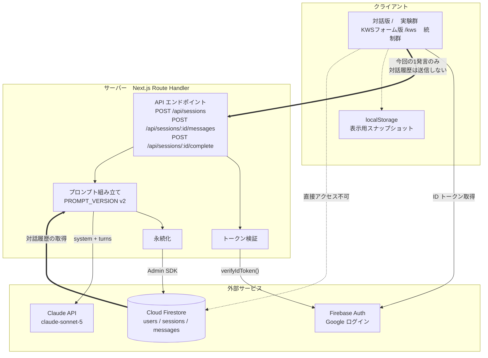
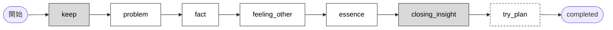
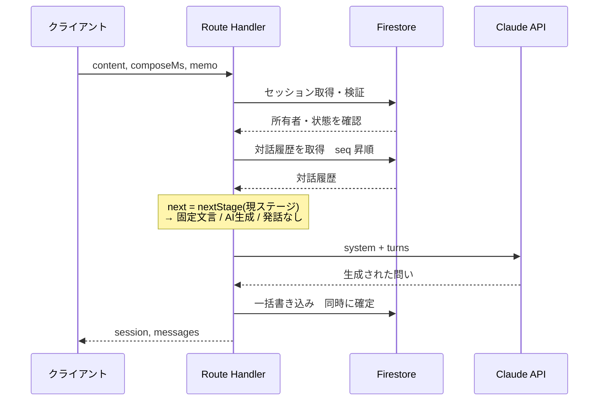

# 論文用 図版

> 2026-09 の学会論文（JSiSE 研究報告）用の図と、その作り方の記録。当時の実装（プロンプト v2、6ターン固定）に基づいており、今の仕様とは一致しない。

本文に載せる図は **2つ**。図2 のみ (a)(b) の2枚組。
このフォルダに SVG が原本としてあり、同名 `.png` は倍率2倍の写し。

| ファイル | 図 | 図が証明すること |
|---|---|---|
| `fig1-system-architecture.svg` | 図1　システム構成図 | **非公開性の技術的証明**。Firestore への直接書き込みを遮断し、サーバー経由でログを一元管理していること |
| `fig2a-stage-transition.svg` | 図2(a)　ステージ遷移 | ALACT モデルに対応する6ステージを決定的に進行させていること |
| `fig2b-fixed-vs-generated.svg` | 図2(b)　固定文言と生成文言 | **条件統制とプロンプト設計の明示**。両端を固定し中間のみ生成させる構造 |

### 本文では使わない補足図

役割の定義から外れたため本文には載せない。付録に回すか、発表スライド用。

| ファイル | 内容 |
|---|---|
| `supplement-turn-sequence.svg` | 1ターンの処理シーケンス |
| `supplement-case-study.svg` | 模擬対話ログのケーススタディ |

---

## 図1 が示していること

証明すべきは2点あり、それぞれ図中の丸数字と対応させてある。

| # | 仕組み | 保証されること |
|---|---|---|
| 1 | セキュリティルールでクライアントからの直接アクセスを遮断 | 対話ログが改ざんされない |
| 2 | `uid` による所有者検証で、自分以外のセッションは取得できない | 他者の目に触れない非公開環境 |

**2 は口頭説明ではなく実装で担保されている。** `getOwnedSession(sessionId, uid)`
（[lib/repository.ts](../../lib/repository.ts)）が uid の一致しないセッションを返さないため、
他の参加者のログは取得経路そのものが存在しない。
「心理的安全性の高い非公開環境」をスローガンでなく技術で示すには、
この所有者検証を図に入れておく必要がある。

クライアント側は2ペイン UI（左が対話、右が常設メモ）であることを図の中に描いてある。

---

## 図2 が示していること

### 図2(a)

6ステージと ALACT モデルの対応。割り当ては [prompt-design.md](../prompt-design.md) §3.1 が正本。

| ステージ | ALACT 上の位置 |
|---|---|
| `Keep` | 行為 (1) の想起の入口 |
| `Problem` | 行為の振り返り (2)　対象場面の特定 |
| `Fact` | 行為の振り返り (2)　事実の想起 |
| `Feeling_Other` | 行為の振り返り (2)　他者視点 |
| `Essence` | 本質的諸相への気づき (3) への移行 |
| `Closing_Insight` | 本質的諸相への気づき (3) の言語化・確定。**測定点** |
| `Try_Plan` | 行為の選択肢の拡大 (4) |
| — | 試行 (5) は次回の PBL 活動。システムの外 |

### 図2(b)

AI の発話7つの固定・生成の別。[prompt-design.md](../prompt-design.md) §2 が正本。

**問いとして自由に生成されるのは中間の4つだけ。** 7番目の Try も `generated: true` だが、
`TRY_PLAN_INSTRUCTION` が新規の助言を禁じているため「自由な生成」ではなく
学生自身の発話の再構成にあたる。図ではこの点を注記で区別してある。

---

## 図表キャプション案

**図の中には説明文を置いていない。** 図が持つのはラベルと凡例だけで、
「なぜそうしているか」「それによって何が言えるか」はキャプションと本文が持つ。
以下はそのままキャプションとして使える文。

> **図1　システム構成。**
> ① クライアントからデータベースへの直接アクセスはセキュリティルールにより遮断されており、
> 対話ログの改ざんを防ぐ。② uid による所有者検証により、自分以外のセッションは取得できず、
> 他者の目に触れない非公開環境を構成する。

> **図2(a)　対話ステージの遷移と ALACT モデルとの対応。**
> 学生の発話は6ターンで、全参加者が同じ順序・同じターン数をたどる。
> 次のステージへの遷移はサーバーが決定し、LLM は関与しない。
> ALACT の試行 (5) は次回の PBL 活動にあたり、システムの外にある。

> **図2(b)　AI の発話における固定文言と生成文言の使い分け。**
> 7つの発話のうち、問いとして自由に生成されるのは中間の4つのみである。
> 締めの問い（Closing_Insight）を全参加者で一字一句揃えることで、
> 回答の差を問いの表現の揺らぎではなく内省の深さに帰属させられる。

---

## 図の縦横比

| 図 | canvas | 想定する掲載幅 | 備考 |
|---|---|---|---|
| 図1 | 880 x 610 | 全段 | 横組み |
| 図2(a) | 580 x 648 | 片段 | **縦組み**。7ステージを横に並べると片段では識別子が読めなくなる |
| 図2(b) | 880 x 424 | 全段 | 表形式なので横組みが合う |

片段 8cm に入れるとき、canvas 幅 900 の図は 1px = 0.09mm になり、
9.5px の識別子が 0.85mm（約2.4pt）まで潰れる。**横に7つ並べる構成は片段では成立しない。**
図2(a) を縦組みにしているのはこのため。片段なら 580 幅までが上限の目安。

---

## 図版の使い方

- **Word / PowerPoint** — SVG をそのまま挿入できる。拡大しても文字が潰れない
- **LaTeX** — SVG は直接使えない。Inkscape で PDF に変換してから `\includegraphics` で読む
  ```
  inkscape fig1-system-architecture.svg --export-type=pdf --export-filename=fig1.pdf
  ```
- **図の中に見出しを入れていない。** 「図1 …」のキャプションは本文側で付ける
- **色を使っていない。** モノクロ印刷でも階調が潰れない。刷りがカラーなら、
  強調箇所にだけ1色足してよい

## 表記の方針

- **図の中に説明文を置かない。** 図が持つのはラベルと凡例だけ。理由・主張・結論はキャプションと本文が持つ
- **カッコ書きの補足を使わない。** 「（実験群）」「（単一トランザクション）」のような
  後置きの説明は、図の中では独立した注記行にする
- 状態の区別は色相ではなく**塗りの濃さ**で行う
- ファイル名・モジュール名は図に入れず、本文で書く

## SVG を編集する場合

SVG はテキストなので直接編集できる。編集後の確認はヘッドレス Chrome が速い。

```
chrome --headless --disable-gpu --hide-scrollbars --force-device-scale-factor=2 --screenshot=out.png --window-size=920,700 file:///<SVGの絶対パス>
```

draw.io で作り直す場合は、以下の作図メモを見ること。

---

# 作図メモ

draw.io で作り直すときの下書き。Mermaid はレイアウトの当たりを見るためのもの。

**最終更新: 2026-09-23 / 対象コード: `PROMPT_VERSION = "v2"`**

---

## 0. 情報量の指針（先に読む）

卒論の図は **片段 8cm / 全段 16cm** で刷られる。この幅で読めない図は載っていないのと同じ。
各図の要素数の上限と、収まらないときに何を捨てるかを先に決めておく。

| 図 | 要素数の上限 | 前回案 | 判定 | 対処 |
|---|---|---|---|---|
| 図1 システム構成 | ボックス10前後 | 18 | **過密** | モジュール名を畳む（§1.1） |
| 図2-a ステージ遷移 | ノード9 + 注釈3 | 9 + 3 | 適正 | そのまま |
| 図2-b 処理シーケンス | ステップ8前後 | 12 | やや過密 | 検証3ステップを1つに畳む |
| 図3 ケーススタディ | 発話6前後 | 13 | **過密** | 本文は抜粋、全文は付録（§3.1） |

**削る順序** — 迷ったらこの順で捨てる。

1. ファイル名・モジュール名（`lib/route-utils.ts` など）→ 本文で書けばよい
2. エラー経路（401/404/409）→ 本文で書けばよい
3. 主張に関わらない構成要素（`/abandon` など）
4. **主張そのものは絶対に捨てない**（図1なら「クライアントは Firestore に触れない」）

図は「全体像の提示」ではなく「ひとつの主張の証明」と考える。
1図1主張に絞れば、情報量は自然に落ちる。

---

## 1. システム構成図

> **主張:** 対話ログはサーバー側で一元管理され、クライアントからの改ざんが原理的にできない。
> 論文の「データの信頼性」節の根拠図。

### 1.1 ボックス構成　10個に絞った版



### 1.2 draw.io での描き分け

| 要素 | 描き方 |
|---|---|
| `localStorage` | **点線の枠** ＋ 注記「表示用であり保存先ではない」 |
| `クライアント → API`　1発言のみ | **太い実線** |
| `Firestore → プロンプト組み立て`　対話履歴の取得 | **太い実線** |
| `クライアント → Firestore` | **赤い点線 ＋ ×印** |

×印の矢印が図1の主役。脇に必ずこの注記を入れる:

```
firestore.rules:  allow read, write: if false;
→ 全アクセスが Route Handler 1箇所に限定される
```

### 1.3 省いた要素　本文で書く

`POST /:id/abandon`、`lib/route-utils.ts`、`runtime: nodejs / maxDuration: 60`、
ストリーミング受信と50秒打ち切り。図に入れると主張がぼやける。

---

## 2. 対話処理フロー図

**2枚に分ける。** 状態遷移と1ターンの処理は粒度が違うので、1枚に詰めると読めなくなる。

### 2-a. ステージ遷移（状態遷移図）



**塗り分けが図2-a の肝。**

| 塗り | 意味 | 該当ステージ |
|---|---|---|
| **灰・塗りつぶし** | 固定文言。`generated: false` | `keep` / `closing_insight` |
| 白・塗りなし | AI 生成。`generated: true` | `problem` / `fact` / `feeling_other` / `essence` |
| 点線枠 | 発話なし。UI にボタンが出るだけ | `try_plan` |

実際に Claude が問いを生成するのは **4ステージだけ**。両端を固定文言にしているのは、
全参加者の入口と締めの問いを一字一句揃えるため。
論文では「問いの差が回答の差に混入しない」という統制の説明に直結する。

**矢印の下に添える注記は3本だけ:**

- `keep` の回答 → `sessions.keep`
- `problem` の回答 → `sessions.problem`
- `closing_insight` の回答 → `sessions.closingInsight` — **内省の深さを測る主要データ**

**統制群を併記する場合** — 比較図として強い— 下に並行して1本:

```
[開始] → Turn 1 → Turn 2 → Turn 3以降 …（任意に打ち切り）→ [completed]
                                    ↑ turnCount >= 3 で Try ボタンが出現
```

> **必ず入れる注記:** 統制群の Turn 1/2/3 の問いの例文は、対話版の
> `fact` / `feeling_other` / `essence` と**意図的に同じ文言**。
> 「問いの中身を揃えたうえで、進行の構造だけを操作している」と書かないと、
> 査読者に「統制が甘い」と誤読される。

### 2-b. 1ターンの処理シーケンス



**分岐 — これが処理の核。菱形で描く。**

| 条件 | 動作 | Claude 呼び出し |
|---|---|---|
| `next === "closing_insight"` | 固定文言を追加 | **なし** |
| `next === "try_plan"` | 何も追加しない | **なし** |
| それ以外 | `generateStageQuestion()` | あり |

**Claude へ渡す構造** — 脇に箱で添える:

```
system = COMMON_SYSTEM
       + STAGE_INSTRUCTIONS[next]
       + 現在の Keep / Problem

turns  = [ 前提文脈  Keep / Problem / Memo ]
       + Firestore から読んだ全履歴
       + 今回のユーザー発話
```

**書き込みは一括で行う。** `messages` への追加と `sessions` の更新
`stage` / `turnCount` / `metrics.*` の加算が同時に確定する。

*省略した要素:* 認証失敗 401、セッション不在 404、完了済み 409、`ClaudeError` の経路。
本文で書けば足りる。

---

## 3. 模擬対話ログのケーススタディ

> **図表キャプションに必ず明記:**
> 「著者が作成した**模擬**対話ログであり、実際の参加者データではない」
> 実データと区別せずに載せると研究倫理上の問題になる。

**場面設定:** チーム開発型 PBL の中間発表当日。
他責的な問題認識から、主体的に向き合うべき課題への転換を示す例。

### 3.1 本文には抜粋だけ載せる

全13発話を1図に詰めると 8cm 幅では読めない。**本文は転換点の3発話＋Try、全文は付録。**

本文用の抜粋 — これで主張は完全に伝わる:

| stage | 話者 | 発話 | 注釈 |
|---|---|---|---|
| `problem` | 学生 | 同じチームのメンバーの担当分が当日の朝になっても出てこなくて、結局わたしが作り直しました。前から何度も期限は共有していたのに、毎回こうなるのが正直しんどいです。 | **他責的な問題認識**<br/>原因を他者に求めている |
| `feeling_other` | 学生 | …たぶん、信用されてないと思ったかもしれません。相談もなく勝手に作り替えられたら、自分なら嫌です。 | **相手の視点への転換**<br/>自分の行動が相手にどう見えたかを考える |
| `closing_insight` | 学生 | メンバーが期限を守らないことが問題だと思っていましたが、たぶん本当の課題は、わたしが「間に合わないかも」と不安になった時点で、それを相手に言わずに抱え込んで先回りしてしまうことです。 | **主体的に向き合うべき課題**<br/>原因が他者から自分の行動へと移る |

**1行目と3行目を線で結び、「問題の捉え直し」とラベルを付ける。**
質問会議の枠組みとの対応が一目で伝わる。

### 3.2 付録用・全文

`generated` 列が `false` の AI 発話seq 0 と 10 は `lib/prompts/v2.ts` の
`FIXED_MESSAGES` から**一字一句そのまま**。論文でもこの文言を変えないこと。

| seq | stage | 話者 | 発話 | generated |
|---|---|---|---|---|
| 0 | keep | AI | 今日のPBL活動、おつかれさまでした。この時間は、あなたの中にあるものを一緒に言葉にしていく時間です。まずは、うまくいったこと・続けたいと思ったことから聞かせてください。 | **false** 固定文言 |
| 1 | keep | 学生 | 今日は中間発表のスライドが一通り形になりました。自分が担当した分は前日に作り終えていたので、当日の朝は落ち着いて練習に回せました。早めに動くのは続けたいです。 | false |
| 2 | problem | AI | 前日までに仕上げて当日を練習に使えたのは、見通しを持って動けた証拠ですね。一方で、今日の活動の中で引っかかったことやモヤモヤしたことがあれば、聞かせてもらえますか。 | true |
| 3 | problem | 学生 | 同じチームのメンバーの担当分が当日の朝になっても出てこなくて、結局わたしが作り直しました。前から何度も期限は共有していたのに、毎回こうなるのが正直しんどいです。 | false |
| 4 | fact | AI | 何度も期限を共有してきたのに、また同じことが起きたのですね。しんどいと感じるのは自然だと思います。その朝のことですが、担当分が出てこないと分かってから、あなたは実際にどう動きましたか。 | true |
| 5 | fact | 学生 | 8時ごろにSlackを見て、まだ上がっていないと気づきました。本人には何も言わずに、自分でスライドを3枚作り直しました。発表30分前に「こっちで作ったから」とだけ送りました。 | false |
| 6 | feeling_other | AI | 本人に確認する前にご自身で作り直して、直前に結果だけを伝えたのですね。そのとき相手の側に立ってみると、あなたのその行動は相手の目にはどのように映っていたと思いますか。 | true |
| 7 | feeling_other | 学生 | …たぶん、信用されてないと思ったかもしれません。相談もなく勝手に作り替えられたら、自分なら嫌です。あとで「ごめん」とだけ返ってきたのが、今思うと気まずかったんだと思います。 | false |
| 8 | essence | AI | 相手の側から見ると、相談なく引き取られたように映ったかもしれない、と。そこに気づけたのは大きいと思います。では、その朝の場面で、あなた自身は本当はどうしたかったのでしょうか。 | true |
| 9 | essence | 学生 | 本当は、一緒に間に合わせたかったんだと思います。発表を失敗したくなかったし、でもそれ以上に、あの人が抜けた状態でチームとして出すのが嫌でした。手伝おうか、って一言聞けばよかった。 | false |
| 10 | closing_insight | AI | ここまでの対話、ありがとうございました。最後にひとつお聞きします。今日の対話を通して、あなた自身が主体的に向き合うべき『本当の課題』は何だと改めて思いましたか？ | **false** 固定文言 |
| 11 | closing_insight | 学生 | メンバーが期限を守らないことが問題だと思っていましたが、たぶん本当の課題は、わたしが「間に合わないかも」と不安になった時点で、それを相手に言わずに抱え込んで先回りしてしまうことです。手を動かす前に一言聞く、それができていません。 | false |
| 12 | try_plan | AI | （下記 Try） | true |

### 3.3 生成された Try（seq 12）

```
・提出物が期限に上がっていないと気づいた時点で、自分で作り直す前に
  本人に「手伝おうか」と一言聞く
・「間に合わないかも」と不安を感じたら、その不安を抱え込まず、
  その日のうちにチームに言葉にして共有する
・担当分を引き取る判断が必要なときは、結果だけを事後に伝えるのではなく、
  引き取る前に相手に相談してから動く
・前日までに自分の担当を仕上げて当日を練習に充てる進め方は、
  今回うまくいったので次回も続ける
```

**各項目から、根拠となる発話へ対応線を引く。**

| Try 項目 | 根拠 |
|---|---|
| 1つ目 | seq 9（「手伝おうか、って一言聞けばよかった」） |
| 2つ目 | seq 11（「不安になった時点で…抱え込んで」） |
| 3つ目 | seq 5・7（結果だけを事後に伝えた／信用されてないと思われた） |
| 4つ目 | seq 1（前日までに仕上げて当日は練習に回した） |

この対応線が図3の**もうひとつの主張**になる。
`TRY_PLAN_INSTRUCTION` は「AI から新しい助言を追加してはいけない」
「各項目は学習者自身が述べた内容に根拠を持つものだけ」と明示している。
対応線は、その制約が実際に効いていることの証拠であり、
**「結局 AI が答えを出しているのでは」という指摘への実装に基づく反論**になる。

### 3.4 保存されるデータ（図の下部に小さく添える）

| フィールド | 値 |
|---|---|
| `condition` | `"dialogue"` |
| `status` | `"completed"` |
| `promptVersion` | `"v2"` |
| `model` / `effort` | `"claude-sonnet-5"` / `"medium"` |
| `turnCount` | `6` |
| `messageCount` | `13` |
| `closingInsight` | seq 11 の全文 |
| `tryPlan` | seq 12 の全文 |

`messageCount: 13` の内訳 = AI 生成5件（問い4 ＋ Try 1）＋ 固定文言2件 ＋ 学生6件。
コードの分岐と一致するので、検算に使える。

---

## 4. 注意点

**`composeMs` を図に入れるかどうか。**
各ユーザー発話の入力所要時間は内省の深さの代理指標として使えるが、
**模擬ログに具体的な秒数を書くと測定値に見えてしまう。**
載せるなら「実データでは各発話に `composeMs` が記録される」という注記に留める。

**図の版とコードの版を一致させること。**
この文書は `PROMPT_VERSION = "v2"` 時点のもの。プロンプトを v3 に上げたら、
固定文言（seq 0 / 10）とステージ構成が変わる可能性がある。
その場合はこの文書と図版の両方を更新する。
